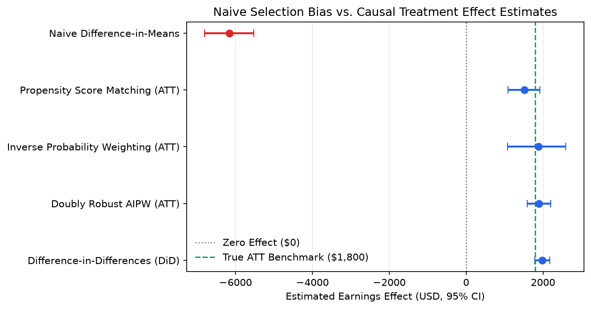
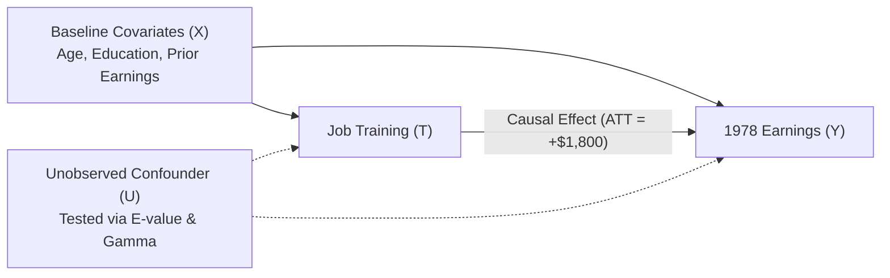
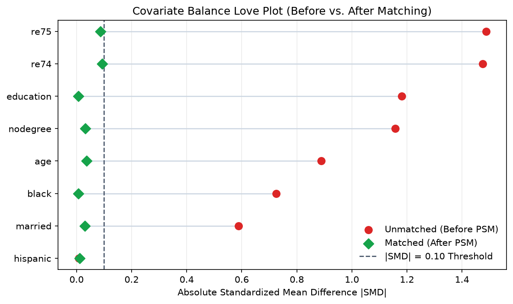

# Causal Inference Study: Job Training Earnings Impact

[](https://causal-inference-study.streamlit.app/)
[](https://colab.research.google.com/github/GaneshArwan/causal_inference_study/blob/main/notebooks/01_eda.ipynb)
[](https://colab.research.google.com/github/GaneshArwan/causal_inference_study/blob/main/notebooks/02_modeling.ipynb)

Observational causal inference pipeline separating selection bias (`-$6,166.37` naive difference) from true job-training earnings impact (`+$1,512.03` to `+$1,976.92` causal ATT vs. `+$1,800.00` benchmark) across `2,675` units.



## Why This Exists

In observational labor studies, workers who enter job training start with lower prior income and fewer years of schooling than non-participants (`max |SMD| = 1.488` on `re75`). A raw mean comparison mistakes that baseline gap for program harm. This project implements four identification strategies side by side, enforces statistical guardrails at every boundary, and tests sensitivity to unmeasured confounding.

## Causal Framework (DAG)



## Dataset

- **Source:** Deterministic LaLonde-calibrated dataset ([lalonde_study.csv](data/lalonde_study.csv)) generated by [src/data_generator.py](src/data_generator.py), modeled after the Dehejia-Wahba NSW + PSID benchmark with known ground-truth ATT (`+$1,800.00`).
- **Dimensions:** `2,675` rows x `10` columns (`298` treated, `2,377` controls).
- **Features:** `treat`, `age`, `education`, `black`, `hispanic`, `married`, `nodegree`, pre-program earnings (`re74`, `re75`), and post-program earnings (`re78`).

## Key Results

### Treatment Effect Comparison (True ATT Benchmark: `+$1,800.00`)

| Method | Estimate | 95% CI | Sample Used |
|--------|----------|--------|-------------|
| Naive Difference-in-Means | `-$6,166.37` | `[-$6,806.81, -$5,525.93]` | `298` treated / `2,377` control |
| Propensity Score Matching (ATT) | `+$1,512.03` | `[+$1,088.21, +$1,915.24]` | `281` matched pairs |
| Inverse Probability Weighting (ATT) | `+$1,877.96` | `[+$1,078.73, +$2,595.50]` | `291` treated / `1,737` control |
| Doubly Robust AIPW (ATT) | `+$1,897.11` | `[+$1,589.73, +$2,204.50]` | `291` treated / `1,737` control |
| Difference-in-Differences (DiD) | `+$1,976.92` | `[+$1,782.22, +$2,171.63]` | `298` treated / `2,377` control |

### Propensity, Balance & Sensitivity Diagnostics

| Diagnostic | Value | Notes |
|------------|-------|-------|
| Propensity 5-Fold CV AUC-ROC | `0.869` | Precision `0.305`, Recall `0.792` at prevalence threshold |
| Common Support Overlap | `75.8%` | `291` treated, `1,737` controls inside `[support_low, support_high]` |
| Max `|SMD|` Before -> After PSM | `1.488 -> 0.093` | Below `0.10` balance threshold (`balanced: true`) |
| E-Value (Point / Lower CI) | `1.801 / 1.621` | VanderWeele & Ding (2017) RR approximation |
| Control Placebo Test | `-$203.43` (`p = 0.3775`) | No spurious signal inside untreated cohort |
| Critical Rosenbaum `Gamma` | `1.55` | Evaluated on `281` independent without-replacement pairs |



## Quickstart

```bash
pip install -r requirements.txt
python src/train.py --locale en
streamlit run app.py
```

Run tests and security checks (requires `requirements-dev.txt`):

```bash
pip install -r requirements-dev.txt
pytest -v
bandit -r src app.py
```

## Architecture & Repository Layout

- `src/schemas.py` — Strict Pydantic v2 config, record, and result models (`allow_inf_nan=False`, `extra="forbid"`).
- `src/guardrails.py` — Path-traversal protection (`validate_safe_path`), full-column vectorized domain checks, positivity overlap checks, post-trimming arm checks, and covariate balance checks.
- `src/data_generator.py` — Deterministic LaLonde-calibrated observational dataset generator.
- `src/causal_engine.py` — Naive ATE, L2 propensity model, optimal 1:1 without-replacement matching (`scipy.optimize.linear_sum_assignment`), Hajek IPW with stratified bootstrap, cross-fitted Ridge AIPW with analytical EIF SE, DiD, and sensitivity suite.
- `src/i18n.py` — `Babel` currency/decimal formatting and bilingual (`en` / `id`) message catalog.
- `src/train.py` — CLI runner generating [results.json](reports/results.json), [causal_report.md](reports/causal_report.md), and 4 PNG figures in `reports/figures/`.
- `app.py` — Interactive Streamlit explorer ([Live Demo](https://causal-inference-study.streamlit.app/)) with live caliper slider, bootstrap control, dynamic plots, and English/Indonesian toggle.
- `notebooks/01_eda.ipynb` & `notebooks/02_modeling.ipynb` — Colab-ready exploratory and modeling notebooks.
- `docs/blog_post.md` — Plain-language methodology write-up.
- `tests/test_causal_study.py` — `11` unit and end-to-end integration tests.

## Methodology & Limitations

- **Structural assumptions:** Matching, IPW, and AIPW rely on conditional ignorability (no unmeasured confounders jointly affecting enrollment and 1978 earnings), positivity (`75.8%` common support), and SUTVA (no spillover between workers). Difference-in-Differences additionally assumes parallel counterfactual earnings trends between 1975 and 1978.
- **Target estimand:** Caliper matching covers `281` of `298` treated units (`94.3%`) and common-support weighting excludes `24.2%` of extreme-propensity observations; estimates apply to the matched / common-support treated subpopulation (ATT), not necessarily the entire labor force.
- **Unobserved shocks:** Sensitivity analysis (`Gamma = 1.55`, `E-value = 1.801`) indicates moderate resilience, but unmeasured time-varying shocks such as local hiring surges or personal health events cannot be ruled out from observational records alone.
