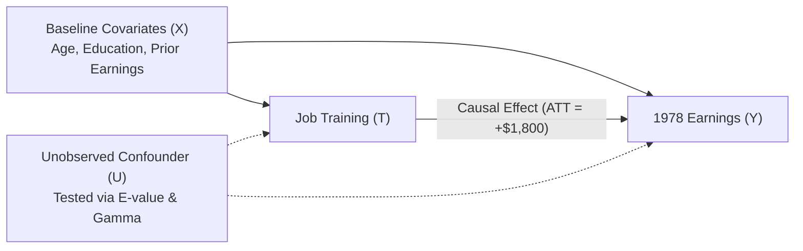

# Causal Inference Study

## Problem Statement
Does participating in a job-training program actually increase post-program earnings, or does a raw comparison mislead decision-makers because lower-income workers disproportionately enroll? This study separates selection bias from true causal impact using observational data.

## Dataset
- **Source:** Deterministic LaLonde-calibrated observational job-training dataset (`data/lalonde_study.csv`, generated via `src/data_generator.py`), modeled after the Dehejia-Wahba NSW + PSID benchmark with known ground-truth ATT (`+$1,800`).
- **Size:** `2,675` observations x `10` columns (`298` treated units, `2,377` control units).
- **Description:** Contains treatment indicator (`treat`), baseline demographics (`age`, `education`, `black`, `hispanic`, `married`, `nodegree`), pre-program earnings (`re74`, `re75`), and post-program earnings (`re78`). Baseline imbalance is severe (maximum absolute standardized mean difference `|SMD| = 1.488` on `re75`), causing a naive mean comparison to reverse the sign of the true effect.

## Causal Framework (DAG)


## Skills Demonstrated
Causal inference, propensity score modeling, 1:1 optimal caliper matching without replacement (PSM), inverse probability weighting (IPW), doubly robust augmented IPW (AIPW), difference-in-differences (DiD), covariate balance auditing, sensitivity analysis (E-value, placebo test, Rosenbaum Gamma), Pydantic v2 schema guardrails, and Babel i18n (`en` / `id`).

## Deliverables
- Causal DAG and diagnostics figures (`reports/figures/dag.png`, `propensity_overlap.png`, `covariate_balance.png`, `effect_comparison.png`)
- Propensity score matching, IPW, AIPW, and DiD estimators (`src/causal_engine.py`)
- Naive selection-bias vs. causal ATT comparison (`reports/results.json`)
- Sensitivity analysis (`E-value`, placebo permutation test, critical Rosenbaum `Gamma`)
- Plain-language written report (`reports/causal_report.md`) and interactive Streamlit app (`app.py`)

## Approach
1. **Data Validation & Guardrails** (`src/schemas.py`, `src/guardrails.py`): Strict Pydantic v2 validation (`allow_inf_nan=False`), full-column domain bounds checks, path-traversal prevention, common-support overlap verification, and post-matching covariate balance checks.
2. **Propensity Modeling** (`src/causal_engine.py`): Standardized L2-regularized logistic regression evaluated with 5-fold stratified cross-validation and restricted to common-support bounds within `[0.01, 0.99]`.
3. **Causal Estimators**: 1:1 optimal bipartite propensity score matching without replacement (`caliper = 0.2 SD`, `281` matched pairs, 200 bootstrap replicates), Hajek-normalized IPW (`291` treated / `1,737` controls on common support), cross-fitted Ridge AIPW with analytical influence-function SE, and two-period DiD (`re78 - re75`).
4. **Sensitivity & Reporting** (`src/train.py`, `src/i18n.py`): Computes VanderWeele-Ding E-values, control-arm placebo tests, and Rosenbaum critical `Gamma` on independent matched pairs, exporting localized reports (`en` and `id`).

## Key Results
### Propensity Model Diagnostics
| Metric | Score |
|--------|-------|
| 5-Fold CV AUC-ROC | 0.869 |
| 5-Fold CV Precision (prevalence threshold) | 0.305 |
| 5-Fold CV Recall (prevalence threshold) | 0.792 |
| Common Support Overlap (`291` treated, `1,737` controls) | 75.8% |
| Max \|SMD\| Before -> After PSM | 1.488 -> 0.093 |

### Treatment Effect Comparison (True ATT Benchmark: +\$1,800.00)
| Method | Estimate | 95% CI |
|--------|----------|--------|
| Naive Difference-in-Means | -\$6,166.37 | [-\$6,806.81, -\$5,525.93] |
| Propensity Score Matching (ATT) | +\$1,512.03 | [+\$1,088.21, +\$1,915.24] |
| Inverse Probability Weighting (ATT) | +\$1,877.96 | [+\$1,078.73, +\$2,595.50] |
| Doubly Robust AIPW (ATT) | +\$1,897.11 | [+\$1,589.73, +\$2,204.50] |
| Difference-in-Differences (DiD) | +\$1,976.92 | [+\$1,782.22, +\$2,171.63] |

## Key Findings
1. **Selection Bias Reversal:** Naive comparison estimates a `-$6,166.37` earnings drop, completely reversing the true `+$1,800` effect due to negative baseline selection on prior earnings and schooling.
2. **Consistent Positive Recovery:** After adjustment, all four causal estimators recover `+$1,512.03` to `+$1,976.92` with 95% confidence intervals strictly above zero and covering the `+$1,800` benchmark, while reducing worst-case covariate imbalance from `1.488` to `0.093` (below the `0.10` threshold).
3. **Robustness to Confounding:** A placebo test on control units shows no spurious effect (`-$203.43`, `p = 0.3775`), while an unmeasured confounder would require an E-value of `1.801` (`1.621` for the lower CI) or Rosenbaum `Gamma = 1.55` across independent matched pairs to overturn statistical significance.

## How to Run
```bash
pip install -r requirements.txt
pip install -r requirements-dev.txt  # for pytest and bandit
python src/train.py --locale en
pytest -v
streamlit run app.py
```

## Files
- `notebooks/01_eda.ipynb` - Exploratory analysis and baseline SMD diagnostics
- `notebooks/02_modeling.ipynb` - Causal estimation and sensitivity checks
- `src/` - Schemas, guardrails, i18n, data generator, causal engine, and CLI runner
- `tests/test_causal_study.py` - Unit and end-to-end integration tests
- `reports/` - Generated JSON results, plain-language report, and figures
- `app.py` - Interactive Streamlit explorer

## Methodology & Limitations
Observational causal inference relies on three untestable structural assumptions: conditional ignorability (no unmeasured confounders jointly driving treatment selection and earnings growth), positivity (non-zero treatment probability across covariate strata), and SUTVA (no interference across individuals). While optimal 1:1 without-replacement matching removes observed imbalance (`max |SMD| = 0.093`) and sensitivity checks show moderate robustness (`Gamma = 1.55`), unobserved time-varying shocks such as sudden local labor-demand shifts or personal motivation changes remain outside the model.

Additionally, Difference-in-Differences requires parallel counterfactual earnings trajectories between treated and control cohorts from 1975 to 1978, and common-support trimming for IPW/AIPW excludes `24.2%` of units outside the overlapping propensity region (`291` treated and `1,737` controls retained; `281` matched pairs retained in caliper PSM). Results should therefore be interpreted as the Average Treatment Effect on the Treated (ATT) within the common-support population.
