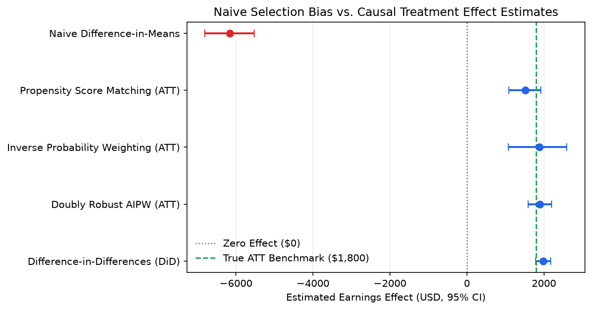
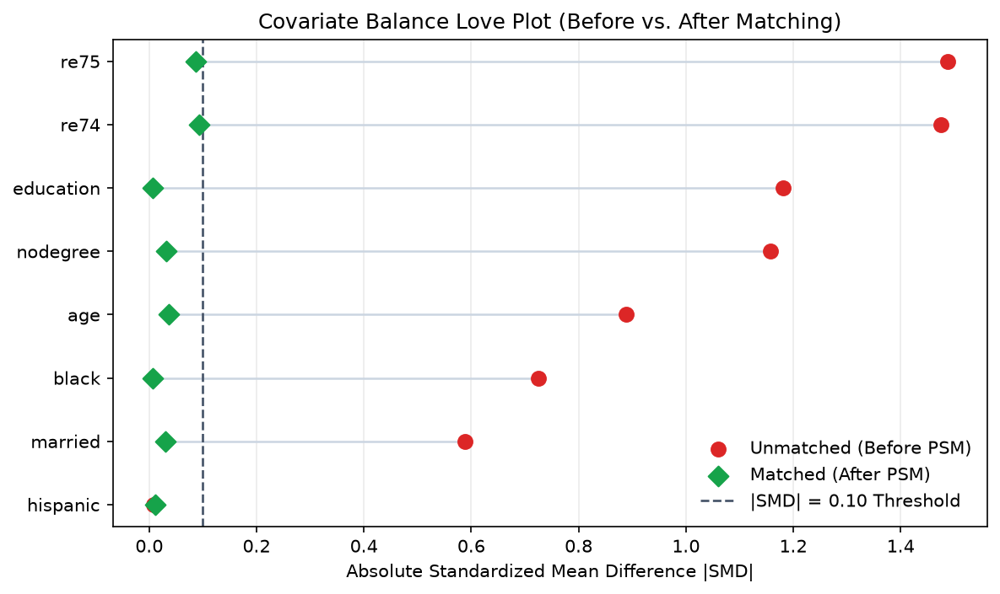

# When Observational Averages Lie: Recovering Job-Training Impact from Selection Bias

Compare raw 1978 earnings between job-training participants and non-participants in our `2,675`-person observational cohort (`298` treated, `2,377` controls), and the training group appears to earn **`$6,166.37` less** per year (`95% CI: -$6,806.81 to -$5,525.93`).

Taken at face value, you would shut the program down. In reality, the true Average Treatment Effect on the Treated (ATT) in this LaLonde-calibrated dataset is **`+$1,800.00`**.

## Why the Naive Estimate Reverses the Sign

In observational data, treatment is not assigned by coin flip. Workers enter job training because they already earn less, hold fewer degrees, and are younger than the broader labor force. Before adjustment, baseline imbalance is severe:

- Prior earnings (`re75`): `|SMD| = 1.488` (`re74`: `1.476`)
- Schooling (`education` / `nodegree`): `|SMD| = 1.181` / `1.158`
- Age (`age`): `|SMD| = 0.889`

Comparing treated workers against the full control pool measures pre-existing economic disadvantage, not program impact.

## Four Estimators That Separate Selection from Causation

Rather than relying on one identification strategy, the pipeline checks whether multiple causal estimators agree:

1. **Optimal 1:1 Propensity Score Matching (without replacement):** Fits standardized L2 logistic regression (`5-fold CV AUC-ROC = 0.869`) and solves optimal bipartite assignment within a `0.2 SD` logit caliper (`281` matched pairs). Worst-case covariate imbalance drops from `|SMD| = 1.488` to `0.093` (below the `0.10` threshold), recovering **`+$1,512.03`** (`95% CI: +$1,088.21 to +$1,915.24`).
2. **Hajek Inverse Probability Weighting (IPW):** Reweights the `1,737` controls on common support (`75.8%` overlap with `291` treated units) to match the treated covariate distribution, yielding **`+$1,877.96`** (`95% CI: +$1,078.73 to +$2,595.50`).
3. **Doubly Robust AIPW:** Combines propensity weights with cross-fitted Ridge outcome regression (`mu0_hat`) and computes analytical Efficient Influence Function standard errors, tightening the interval to **`+$1,897.11`** (`95% CI: +$1,589.73 to +$2,204.50`).
4. **Difference-in-Differences (`re78 - re75`):** Subtracts each worker's own 1975 baseline earnings to remove time-invariant differences, estimating **`+$1,976.92`** (`95% CI: +$1,782.22 to +$2,171.63`).

## How Much Unmeasured Confounding Would Break the Result?

Observational matching only balances variables you observe (`age`, `education`, `black`, `hispanic`, `married`, `nodegree`, `re74`, `re75`). Three checks probe what happens if something was missed:

- **Control-arm placebo test:** Randomly assigning fake treatment inside the control group yields `-$203.43` (`p = 0.3775`), showing no spurious signal where none exists.
- **VanderWeele-Ding E-value:** Point estimate E-value is **`1.801`** (`1.621` for the lower CI bound) — an omitted variable would need at least a `1.62x` risk-ratio association with both enrollment and earnings to explain away the positive lower bound.
- **Rosenbaum sensitivity (`Gamma`):** On the `281` independent without-replacement matched pairs, hidden bias would have to shift treatment odds by **`1.55x`** before the one-sided sign test loses significance (`p > 0.05`).

## Takeaways for Applied Data Science

- **Check overlap and balance before reading an effect estimate.** Without common-support trimming (`[support_low, support_high]`) and post-match `|SMD| <= 0.10` verification, propensity methods silently extrapolate.
- **Match without replacement when running sign tests.** Reusing controls inflates effective sample size and overstates Rosenbaum `Gamma`; optimal bipartite matching keeps pairs independent.
- **Triangulate across assumptions.** Agreement between matching/weighting (conditional ignorability) and Difference-in-Differences (parallel trends) builds stronger evidence than any single model.
